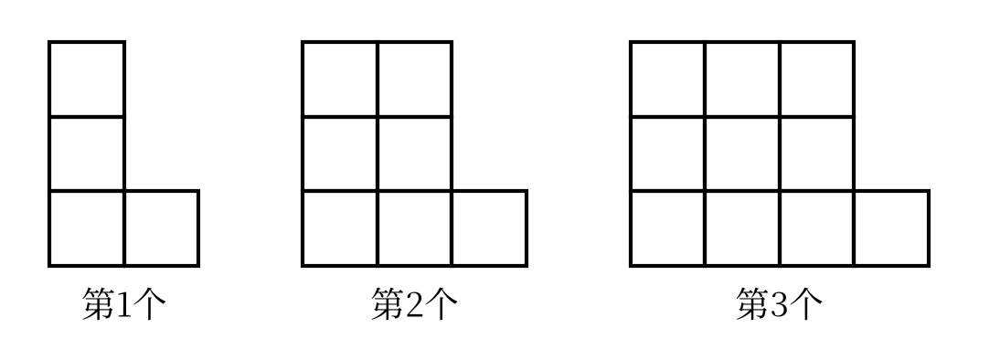
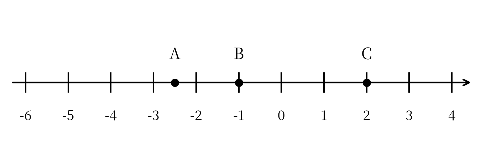
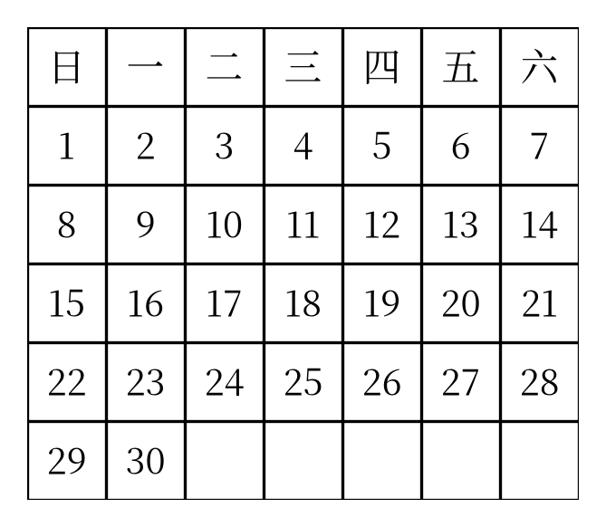

::: {custom-style="Subtitle"}
（人教版2024新教材　范围：第一章～第三章）
:::

::: {custom-style="Subtitle"}
满分120分　　考试时间120分钟
:::

::: {custom-style="Subtitle"}
班级：＿＿＿＿＿＿　　姓名：＿＿＿＿＿＿　　学号：＿＿＿＿＿＿　　得分：＿＿＿＿
:::

## 一、选择题（本大题共12个小题，每小题3分，共36分。在每小题给出的四个选项中，只有一项符合题目要求）

1．如果收入100元记作 $+100$ 元，那么支出60元记作（　　）

A．$+60$ 元　　　B．$-60$ 元　　　C．$-40$ 元　　　D．$+160$ 元

2．下列各数中，属于负分数的是（　　）

A．$-2$　　　B．$0.25$　　　C．$-\frac{7}{4}$　　　D．$-(-3)$

3．在数轴上，把表示 $-2$ 的点向右移动5个单位长度，所得点表示的数是（　　）

A．$-7$　　　B．$-3$　　　C．$3$　　　D．$7$

4．下列说法正确的是（　　）

A．$0$ 是最小的有理数　　　B．一个数的绝对值一定是正数

C．相反数等于它本身的数只有 $0$　　D．若 $|a|=|b|$，则 $a=b$

5．计算 $(-12)+5-(-8)$ 的结果是（　　）

A．$1$　　　B．$-15$　　　C．$9$　　　D．$-9$

6．计算 $(-2)^{4}$ 与 $-2^{4}$ 的结果分别是（　　）

A．$16$，$-16$　　　B．$-16$，$16$　　　C．$16$，$16$　　　D．$-16$，$-16$

7．计算 $-2^{2}-(-3)\times 2$ 的结果是（　　）

A．$2$　　　B．$-2$　　　C．$10$　　　D．$-10$

8．下列各式中，符合代数式书写规范的是（　　）

A．$1\frac{1}{2}x$　　　B．$x\times 5$　　　C．$\frac{3a}{4}$　　　D．$a\div b$

9．某商品原价为 $a$ 元，先提价20%，再降价20%，则现在的价格是（　　）

A．$a$ 元　　　B．$0.96a$ 元　　　C．$1.04a$ 元　　　D．$0.8a$ 元

10．已知 $a+b=5$，则 $2a+2b-3$ 的值是（　　）

A．$7$　　　B．$10$　　　C．$4$　　　D．$13$

11．某市出租车起步价8元（含3千米），超过部分每千米2元，行驶 $x$ 千米（$x>3$）的车费为（　　）

A．$8+2x$ 元　　　B．$2x$ 元　　　C．$8+2(x-3)$ 元　　　D．$8-2(x-3)$ 元

12．观察：$1^{3}=1$，$1^{3}+2^{3}=9$，$1^{3}+2^{3}+3^{3}=36$，…，则 $1^{3}+2^{3}+3^{3}+\cdots+10^{3}$ 的值是（　　）

A．$3025$　　　B．$2500$　　　C．$2025$　　　D．$3600$

## 二、填空题（本大题共6个小题，每小题4分，共24分）

13．$-|-3|$ 的相反数是　　　　．

14．数轴上与表示 $-1$ 的点相距3个单位长度的点所表示的数是　　　　．

15．计算：$(-2)^{3}\div 4-(-1)$=　　　　．

16．据国家统计局公布，某年全国粮食总产量约为695000000吨，用科学记数法表示为　　　　吨．

17．若 $|a-2|+|b+3|=0$，则 $a+b$=　　　　．

18．如图，用同样规格的小正方形按下列方式摆放：

{width=9cm}

（1）第5个图形用　　　　个小正方形；

（2）第 $n$ 个图形用　　　　个小正方形（用含 $n$ 的代数式表示）．

## 三、解答题（本大题共8个小题，共60分。解答应写出必要的文字说明、演算步骤或推理过程）

19．（6分）计算：

（1）$12-(-18)+(-7)-15$；

（2）$\left(-\frac{1}{2}+\frac{2}{3}-\frac{3}{4}\right)\times(-24)$．

```{=openxml}
<w:p/><w:p/><w:p/><w:p/><w:p/>
```

20．（6分）把下列各数分别填入相应的集合中：

$-5$，$0.3$，$0$，$-\frac{22}{7}$，$-|-2|$，$-(-3)$，$3.14$，$-\frac{1}{4}$．

正整数集合：｛　　　　　　　　…｝；

负分数集合：｛　　　　　　　　…｝；

非负整数集合：｛　　　　　　　　…｝．

```{=openxml}
<w:p/><w:p/><w:p/>
<w:p><w:r><w:br w:type="page"/></w:r></w:p>
```

21．（8分）如图，数轴上点 $A$，$B$，$C$ 分别表示三个有理数。

{width=10cm}

（1）点 $A$ 表示的数是　　　　，点 $C$ 表示的数是　　　　；（2分）

（2）将点 $B$ 向左移动4个单位长度得到点 $D$，点 $D$ 表示的数是　　　　；（2分）

（3）比较点 $A$，$B$，$C$ 表示的数的大小，并用“$<$”连接。（4分）

```{=openxml}
<w:p/><w:p/><w:p/><w:p/><w:p/><w:p/>
```

22．（8分）某地一天的气温变化情况如下：清晨气温为 $-6$ ℃，中午气温比清晨上升了11 ℃，傍晚气温比中午下降了7 ℃，夜间气温又比傍晚下降了5 ℃。

（1）求中午的气温；（2分）

（2）求夜间的气温；（3分）

（3）求这一天最高气温与最低气温的差。（3分）

```{=openxml}
<w:p/><w:p/><w:p/><w:p/><w:p/><w:p/>
```

23．（8分）某文具店一周五天的销售盈亏情况如下表（盈利记为正，亏损记为负）：

| 星期 | 一 | 二 | 三 | 四 | 五 |
|:---:|:---:|:---:|:---:|:---:|:---:|
| 盈亏/元 | $+150$ | $-30$ | $+80$ | $-45$ | $+65$ |

（1）求这一周的总盈亏；（3分）

（2）盈利最多的一天比亏损最多的一天多盈利多少元？（3分）

（3）若该店每天需支付房租等费用50元，求这五天扣除费用后的盈亏情况。（2分）

```{=openxml}
<w:p/><w:p/><w:p/><w:p/><w:p/><w:p/>
```

24．（8分）一个两位数，十位上的数字是 $a$，个位上的数字是 $b$（$a$，$b$ 都不为0）。

（1）用含 $a$，$b$ 的代数式表示这个两位数；（3分）

（2）若 $a=3$，$b=5$，求这个两位数的值；（2分）

（3）若 $a=3$，$b=5$，把这个两位数的十位数字与个位数字交换位置得到一个新两位数，求新两位数与原两位数的差。（3分）

```{=openxml}
<w:p/><w:p/><w:p/><w:p/>
```

25．（8分）如图是2026年11月的月历。

{width=7.5cm}

（1）用 $2\times 2$ 方框框出四个数（如图中相邻两行、相邻两列），若框出的四个数之和为64，求方框中左上角的数；（4分）

（2）用 $3\times 3$ 方框框出的九个数之和能否等于202？请说明理由。（4分）

```{=openxml}
<w:p/><w:p/><w:p/><w:p/>
```

26．（8分）已知 $|a|=3$，$|b|=2$，且 $a<b$。

（1）写出 $a$，$b$ 所有可能的取值组合；（4分）

（2）求 $a+b$ 的所有可能的值。（4分）

```{=openxml}
<w:p/><w:p/><w:p/><w:p/>
<w:p><w:r><w:br w:type="page"/></w:r></w:p>
```

## 参考答案与解析（第一套）

### 一、选择题（每小题3分，共36分）

| 题号 | 1 | 2 | 3 | 4 | 5 | 6 | 7 | 8 | 9 | 10 | 11 | 12 |
|:---:|:---:|:---:|:---:|:---:|:---:|:---:|:---:|:---:|:---:|:---:|:---:|:---:|
| 答案 | B | C | C | C | A | A | A | C | B | A | C | A |

### 二、填空题（每小题4分，共24分）

| 题号 | 13 | 14 | 15 |
|:---:|:---:|:---:|:---:|
| 答案 | $3$ | $-4$ 或 $2$ | $-1$ |
| 题号 | 16 | 17 | 18 |
| 答案 | $6.95\times 10^{8}$ | $-1$ | 16；$3n+1$ |

### 三、解答题

19．（6分）

（1）原式：$12+18-7-15=30-22=8$．（3分）

（2）原式：$\left(-\frac{1}{2}\right)\times(-24)+\frac{2}{3}\times(-24)-\frac{3}{4}\times(-24)=12-16+18=14$．（3分）

20．（6分）

正整数集合：｛$-(-3)$，…｝，即｛3，…｝．（2分）

负分数集合：｛$-\frac{22}{7}$，$-\frac{1}{4}$，…｝．（2分）

非负整数集合：｛$0$，$-(-3)$，…｝，即｛0，3，…｝．（2分）

> 易错点：$0.3$ 与 $3.14$ 是正分数（可化为分数），$-|-2|=-2$ 是负整数，都不属于负分数集合；0既不是正数也不是负数，但它是非负整数。

21．（8分）

（1）$-2.5$；$2$．（2分）

（2）$-1-4=-5$，故点 $D$ 表示的数是 $-5$．（2分）

（3）因为数轴上右边的点表示的数总比左边的点表示的数大，所以 $-2.5<-1<2$．（4分）

22．（8分）

（1）$-6+11=5$（℃）．答：中午的气温是5 ℃．（2分）

（2）$5-7=-2$（℃），$-2-5=-7$（℃）．答：夜间的气温是 $-7$ ℃．（3分）

（3）这一天最高气温是5 ℃，最低气温是 $-7$ ℃，$5-(-7)=12$（℃）．答：最高气温与最低气温的差是12 ℃．（3分）

23．（8分）

（1）$(+150)+(-30)+(+80)+(-45)+(+65)=220$（元）．答：这一周盈利220元．（3分）

（2）盈利最多的是星期一（$+150$ 元），亏损最多的是星期四（$-45$ 元），$150-(-45)=195$（元）．答：多盈利195元．（3分）

（3）五天共支出 $50\times 5=250$（元），$220-250=-30$（元）．答：扣除费用后亏损30元．（2分）

24．（8分）

（1）这个两位数是 $10a+b$．（3分）

（2）当 $a=3$，$b=5$ 时，$10a+b=10\times 3+5=35$．（2分）

（3）交换后得到的新两位数是 $10b+a$，当 $a=3$，$b=5$ 时，新数为 $53$，$53-35=18$．（3分）

25．（8分）

（1）设方框中左上角的数为 $x$，则其余三个数分别为 $x+1$，$x+7$，$x+8$，由题意得四个数之和为 $x+(x+1)+(x+7)+(x+8)=4x+16$．由 $4x+16=64$ 得 $4x=48$，$x=12$．答：方框中左上角的数是12．（4分）

（2）设 $3\times 3$ 方框中左上角的数为 $y$，则九个数的和为 $9y+72=9(y+8)$，它一定是9的倍数．而 $202$ 不是9的倍数（$202=9\times 22+4$），所以框出的九个数之和不能等于202．（4分）

26．（8分）

（1）由 $|a|=3$ 得 $a=3$ 或 $a=-3$；由 $|b|=2$ 得 $b=2$ 或 $b=-2$．因为 $a<b$，所以可能的情况为：$a=-3$，$b=2$；$a=-3$，$b=-2$．（4分）

（2）当 $a=-3$，$b=2$ 时，$a+b=-1$；当 $a=-3$，$b=-2$ 时，$a+b=-5$．所以 $a+b$ 的值为 $-1$ 或 $-5$．（4分）

> 易错点：不要漏掉 $a=3$ 的情形——此时 $b=2$ 或 $b=-2$ 都使 $a<b$ 不成立，故不满足条件。
