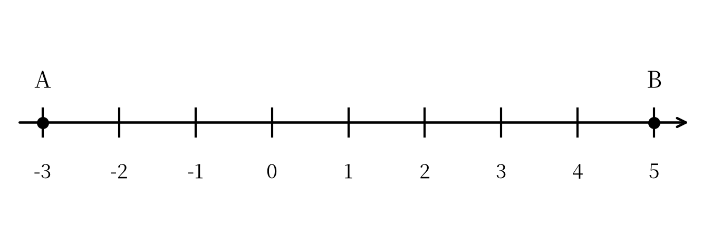
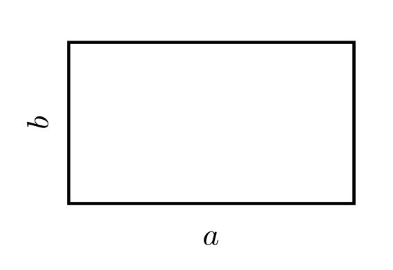
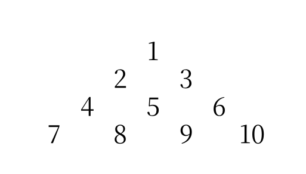

::: {custom-style="Subtitle"}
（人教版2024新教材　范围：第一章～第三章）
:::

::: {custom-style="Subtitle"}
满分120分　　考试时间120分钟
:::

::: {custom-style="Subtitle"}
班级：＿＿＿＿＿＿　　姓名：＿＿＿＿＿＿　　学号：＿＿＿＿＿＿　　得分：＿＿＿＿
:::

## 一、选择题（本大题共12个小题，每小题3分，共36分。在每小题给出的四个选项中，只有一项符合题目要求）

1．珠峰海拔约8848米，吐鲁番盆地最低处海拔约 $-154$ 米，两地海拔相差（　　）

A．$9002$ 米　　　B．$8694$ 米　　　C．$-9002$ 米　　　D．$8848$ 米

2．下列各数：$-2.5$，$0$，$\frac{3}{4}$，$-(-1)$，$-|-4|$，其中负整数有（　　）

A．1个　　　B．2个　　　C．3个　　　D．4个

3．数轴上点 $M$ 表示的数是 $-4$，点 $N$ 表示的数是 $2$，则线段 $MN$ 的中点表示的数是（　　）

A．$-1$　　　B．$-2$　　　C．$1$　　　D．$3$

4．若 $|a|=-a$，则 $a$ 的取值范围是（　　）

A．$a>0$　　　B．$a<0$　　　C．$a\leq 0$　　　D．$a\geq 0$

5．计算 $(-3)\times(-4)\div(-2)$ 的结果是（　　）

A．$6$　　　B．$-6$　　　C．$24$　　　D．$-24$

6．$(-2)^{3}$ 与 $-2^{3}$ 的关系是（　　）

A．相等　　　B．互为相反数　　　C．互为倒数　　　D．无法确定

7．计算 $(-1)^{2026}-(-2)^{3}\div 4$ 的结果是（　　）

A．$3$　　　B．$1$　　　C．$-1$　　　D．$-3$

8．用代数式表示“比 $a$ 的2倍少3的数”，正确的是（　　）

A．$2(a-3)$　　　B．$2a-3$　　　C．$3-2a$　　　D．$a-6$

9．当 $a=-2$，$b=1$ 时，代数式 $3a-2b+1$ 的值是（　　）

A．$-7$　　　B．$-3$　　　C．$3$　　　D．$7$

10．下列各式中，$y$ 与 $x$ 成反比例关系的是（　　）

A．$y=2x$　　　B．$xy=6$　　　C．$y=x-1$　　　D．$y=x^{2}$

11．若 $x$ 表示两位数，$y$ 表示三位数，把 $y$ 放在 $x$ 左边组成五位数，则这个五位数是（　　）

A．$y+x$　　　B．$1000y+x$　　　C．$100y+x$　　　D．$1000x+y$

12．观察下列一组数：$-\frac{1}{2}$，$\frac{1}{3}$，$-\frac{1}{4}$，$\frac{1}{5}$，…，按此规律，第2026个数是（　　）

A．$\frac{1}{2026}$　　　B．$\frac{1}{2027}$　　　C．$-\frac{1}{2026}$　　　D．$-\frac{1}{2027}$

## 二、填空题（本大题共6个小题，每小题4分，共24分）

13．若 $|a|=4$，且 $a<0$，则 $a$=　　　　．

14．数轴上点 $A$ 表示 $-1$，点 $B$ 表示 $5$，则 $AB$=　　　　，$AB$ 中点表示的数是　　　　．

15．计算：$(-1)^{2026}+(-1)^{2025}+(-1)^{2024}$=　　　　．

16．用四舍五入法把 $3.14159$ 精确到千分位是　　　　；近似数 $2.30$ 精确到　　　　位．

17．已知 $a^{2}-2a=3$，则 $2a^{2}-4a+1$=　　　　．

18．用火柴棒按下列方式搭三角形：

{width=11cm}

（1）第 $n$ 个图形用　　　　根火柴棒（用含 $n$ 的代数式表示）；

（2）第20个图形用　　　　根火柴棒．

## 三、解答题（本大题共8个小题，共60分。解答应写出必要的文字说明、演算步骤或推理过程）

19．（6分）计算：

（1）$-6+(-4)-(-9)+2$；

（2）$(-2)^{4}\div(-8)-(-5)$．

```{=openxml}
<w:p/><w:p/><w:p/><w:p/><w:p/>
```

20．（6分）用简便方法计算：

（1）$(-36)\times\left(\frac{5}{9}-\frac{3}{4}+\frac{1}{6}\right)$；

（2）$\left(-\frac{7}{2}\right)\times\left(-\frac{4}{7}\right)$．

```{=openxml}
<w:p/><w:p/><w:p/><w:p/><w:p/>
<w:p><w:r><w:br w:type="page"/></w:r></w:p>
```

21．（8分）如图，数轴上点 $A$ 表示的数是 $-3$，点 $B$ 表示的数是 $5$。

{width=10cm}

（1）求 $A$，$B$ 两点之间的距离；（2分）

（2）若数轴上点 $C$ 表示的数是 $x$，且 $A$，$C$ 两点间的距离为2，求 $x$ 的值；（3分）

（3）若点 $D$ 是线段 $AB$ 的中点，求点 $D$ 表示的数。（3分）

```{=openxml}
<w:p/><w:p/><w:p/><w:p/><w:p/><w:p/>
```

22．（8分）某水库以警戒水位为0米，一周内水位的变化情况如下表（上升记为正，下降记为负）：

| 星期 | 一 | 二 | 三 | 四 | 五 | 六 | 日 |
|:---:|:---:|:---:|:---:|:---:|:---:|:---:|:---:|
| 水位变化/米 | $+0.3$ | $-0.2$ | $+0.5$ | $-0.4$ | $+0.1$ | $-0.6$ | $+0.2$ |

（1）周日结束时，水位相对警戒水位是上升还是下降？变化了多少米？（2分）

（2）这一周中水位最高出现在星期几？比警戒水位高多少米？（3分）

（3）这一周最高水位与最低水位相差多少米？（3分）

```{=openxml}
<w:p/><w:p/><w:p/><w:p/><w:p/><w:p/>
```

23．（8分）规定一种新运算“$*$”：$a*b=ab-a+b$。例如：$1*2=1\times 2-1+2=3$。

（1）求 $(-2)*3$ 的值；（3分）

（2）求 $[2*(-3)]*4$ 的值；（3分）

（3）$a*b$ 与 $b*a$ 的结果一定相等吗？若不一定，请举出一个反例。（2分）

```{=openxml}
<w:p/><w:p/><w:p/><w:p/><w:p/><w:p/>
```

24．（8分）如图，一个长方形的长为 $a$ cm，宽为 $b$ cm。

{width=6cm}

（1）用代数式表示这个长方形的周长；（3分）

（2）用代数式表示这个长方形的面积；（2分）

（3）若把这个长方形的长增加3 cm，宽不变，则它的周长增加多少厘米？（3分）

```{=openxml}
<w:p/><w:p/><w:p/><w:p/><w:p/><w:p/>
```

25．（8分）观察下列数阵的排列规律：

{width=5cm}

（1）第6行的第1个数是多少？（3分）

（2）第10行所有数的和是多少？（3分）

（3）第 $n$ 行最后一个数是多少？（用含 $n$ 的代数式表示）（2分）

```{=openxml}
<w:p/><w:p/><w:p/><w:p/><w:p/><w:p/>
```

26．（8分）

（1）数轴上表示 $x$ 与 $-3$ 的两点之间的距离可以表示为　　　　（用含 $x$ 的式子表示）；（2分）

（2）求 $|x-2|+|x+3|$ 的最小值，并写出此时 $x$ 的取值范围；（3分）

（3）若 $|x-2|+|x+3|=9$，求 $x$ 的值。（3分）

```{=openxml}
<w:p><w:r><w:br w:type="page"/></w:r></w:p>
```

## 参考答案与解析（第二套）

### 一、选择题（每小题3分，共36分）

| 题号 | 1 | 2 | 3 | 4 | 5 | 6 | 7 | 8 | 9 | 10 | 11 | 12 |
|:---:|:---:|:---:|:---:|:---:|:---:|:---:|:---:|:---:|:---:|:---:|:---:|:---:|
| 答案 | A | A | A | C | B | A | A | B | A | B | B | B |

### 二、填空题（每小题4分，共24分）

| 题号 | 13 | 14 | 15 |
|:---:|:---:|:---:|:---:|
| 答案 | $-4$ | $6$；$2$ | $1$ |
| 题号 | 16 | 17 | 18 |
| 答案 | $3.142$；百分位 | $7$ | $2n+1$；41 |

### 三、解答题

19．（6分）

（1）原式：$-6-4+9+2=1$．（3分）

（2）原式：$16\div(-8)+5=-2+5=3$．（3分）

20．（6分）

（1）原式：$(-36)\times\frac{5}{9}+(-36)\times\left(-\frac{3}{4}\right)+(-36)\times\frac{1}{6}=-20+27-6=1$．（3分）

（2）原式：$\frac{7}{2}\times\frac{4}{7}=2$．（3分）

21．（8分）

（1）$AB=5-(-3)=8$．答：$A$，$B$ 两点之间的距离是8．（2分）

（2）由 $AC=2$ 知，点 $C$ 到点 $A$ 的距离是2，所以 $x=-3+2=-1$ 或 $x=-3-2=-5$．答：$x$ 的值是 $-1$ 或 $-5$．（3分）

（3）线段 $AB$ 的中点表示的数为 $\frac{-3+5}{2}=1$．答：点 $D$ 表示的数是1．（3分）

22．（8分）

（1）$(+0.3)+(-0.2)+(+0.5)+(-0.4)+(+0.1)+(-0.6)+(+0.2)=-0.1$（米）．答：水位下降了，比警戒水位低0.1米．（2分）

（2）逐日累计水位为：0.3，0.1，0.6，0.2，0.3，$-0.3$，$-0.1$（米），最高出现在星期三，为 $+0.6$ 米．答：星期三水位最高，比警戒水位高0.6米．（3分）

（3）最高水位为 $+0.6$ 米，最低水位为 $-0.3$ 米，$0.6-(-0.3)=0.9$（米）．答：相差0.9米．（3分）

23．（8分）

（1）$(-2)*3=(-2)\times 3-(-2)+3=-6+2+3=-1$．（3分）

（2）$2*(-3)=2\times(-3)-2+(-3)=-11$；$[2*(-3)]*4=(-11)*4=(-11)\times 4-(-11)+4=-44+11+4=-29$．（3分）

（3）不一定相等．反例：$1*2=1\times 2-1+2=3$，而 $2*1=2\times 1-2+1=1$，$3\neq 1$．（2分）

24．（8分）

（1）这个长方形的周长是 $2(a+b)$ cm．（3分）

（2）这个长方形的面积是 $ab$ cm²．（2分）

（3）长增加3 cm后，周长为 $2(a+3+b)$ cm，比原来增加 $2\times 3=6$（cm）．答：周长增加6 cm．（3分）

25．（8分）

（1）前5行共有 $1+2+3+4+5=15$（个）数，所以第6行的第1个数是16．（3分）

（2）前9行共有 $1+2+\cdots+9=45$（个）数，第10行的10个数为46，47，…，55，它们的和为 $\frac{(46+55)\times 10}{2}=505$．（3分）

（3）第 $n$ 行最后一个数是 $1+2+\cdots+n=\frac{n(n+1)}{2}$．（2分）

26．（8分）

（1）$|x+3|$．（2分）

（2）$|x-2|+|x+3|$ 表示数轴上表示 $x$ 的点到表示2的点与表示 $-3$ 的点的距离之和。当表示 $x$ 的点在表示 $-3$ 与2的两点之间（含端点）时，这个和最小，最小值为 $2-(-3)=5$，此时 $-3\leq x\leq 2$．（3分）

（3）当 $x>2$ 时，$(x-2)+(x+3)=9$，得 $2x+1=9$，$x=4$；当 $x<-3$ 时，$(2-x)+(-3-x)=9$，得 $x=-5$．经检验，$x=4$，$x=-5$ 都满足条件．答：$x$ 的值是4或 $-5$．（3分）

> 易错点：第（3）问中，当 $-3\leq x\leq 2$ 时，和恒为5，不可能等于9，所以只有两种情形，不能漏解。
