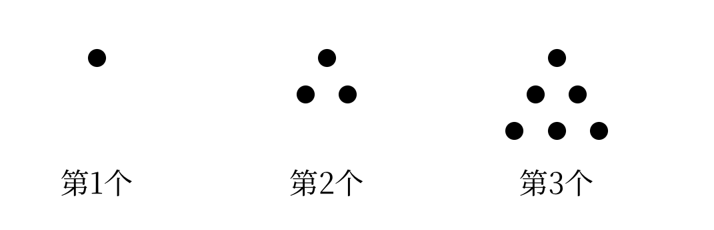
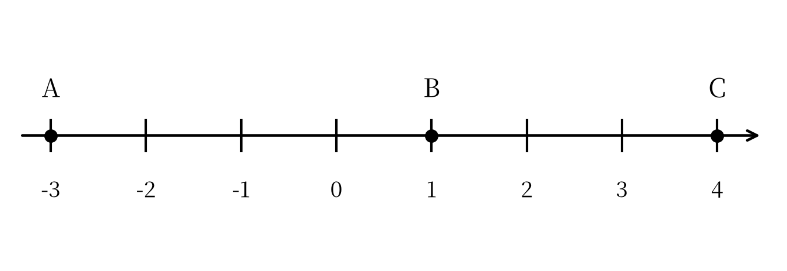
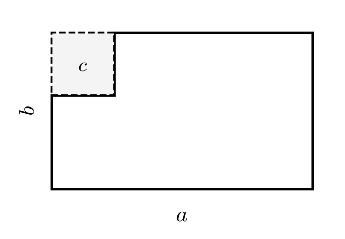

::: {custom-style="Subtitle"}
（人教版2024新教材　范围：第一章～第三章）
:::

::: {custom-style="Subtitle"}
满分120分　　考试时间120分钟
:::

::: {custom-style="Subtitle"}
班级：＿＿＿＿＿＿　　姓名：＿＿＿＿＿＿　　学号：＿＿＿＿＿＿　　得分：＿＿＿＿
:::

## 一、选择题（本大题共12个小题，每小题3分，共36分。在每小题给出的四个选项中，只有一项符合题目要求）

1．若把顺时针旋转 $90^{\circ}$ 记作 $+90^{\circ}$，则逆时针旋转 $60^{\circ}$ 应记作（　　）

A．$+60^{\circ}$　　　B．$-60^{\circ}$　　　C．$+30^{\circ}$　　　D．$-30^{\circ}$

2．下列比较大小正确的是（　　）

A．$-|-2|>-(-1)$　　　B．$-|-2|<-(-1)$　　　C．$|-2|<-(-1)$　　　D．$-(-2)<-|-2|$

3．将数轴折叠，使表示 $-2$ 的点与表示 $4$ 的点重合，则折痕处表示的数是（　　）

A．$-1$　　　B．$0$　　　C．$1$　　　D．$3$

4．下列说法正确的是（　　）

A．$0$ 的倒数是 $0$　　　B．倒数等于它本身的数只有 $1$

C．负数没有倒数　　　D．若 $a$，$b$ 互为倒数，则 $ab=1$

5．计算 $-1-[2-(-3)^{2}]$ 的结果是（　　）

A．$6$　　　B．$-6$　　　C．$8$　　　D．$-8$

6．将 $3250000$ 用科学记数法表示为（　　）

A．$3.25\times 10^{5}$　　　B．$3.25\times 10^{6}$　　　C．$32.5\times 10^{5}$　　　D．$0.325\times 10^{7}$

7．计算 $-3^{2}\div(-2)$ 的结果是（　　）

A．$\frac{9}{2}$　　　B．$-\frac{9}{2}$　　　C．$9$　　　D．$-9$

8．用代数式表示“$a$ 与 $b$ 的平方差”的是（　　）

A．$a^{2}-b^{2}$　　　B．$(a-b)^{2}$　　　C．$a-b^{2}$　　　D．$b^{2}-a^{2}$

9．当 $x=\frac{1}{2}$，$y=-2$ 时，代数式 $2x-y^{2}$ 的值是（　　）

A．$-3$　　　B．$3$　　　C．$5$　　　D．$-5$

10．若 $|a|=2$，$b=3$，且 $a<b$，则 $a+b$ 的值是（　　）

A．$5$　　　B．$1$　　　C．$5$ 或 $1$　　　D．$-5$ 或 $-1$

11．某小组5名学生的平均分为 $m$ 分，其中4名的平均分为 $n$ 分，则第5名学生的分数是（　　）

A．$5m-4n$　　　B．$5m+4n$　　　C．$\frac{5m-4n}{5}$　　　D．$m-n$

12．某种袋装食品标有“净含量：$500\pm 5$ 克”，则一袋净含量最多为（　　）

A．$495$ 克　　　B．$500$ 克　　　C．$505$ 克　　　D．$510$ 克

## 二、填空题（本大题共6个小题，每小题4分，共24分）

13．计算：$-2+6-9$=　　　　．

14．计算：$-2^{3}-(-3)\times\left(-\frac{1}{3}\right)$=　　　　．

15．比较大小：$-\frac{5}{7}$　　　$-\frac{3}{4}$（填“＞”“＜”或“＝”）．

16．某剧场第一排有 $a$ 个座位，以后每一排都比前一排多2个座位，则第 $n$ 排有　　　　个座位（用含 $a$，$n$ 的代数式表示）．

17．若 $|a-3|+(b+2)^{2}=0$，则 $b^{a}$=　　　　．

18．如图，用同样大小的小圆点按下列方式摆放成三角形：

{width=9cm}

（1）第6个图形有　　　　个小圆点；

（2）第 $n$ 个图形有　　　　个小圆点（用含 $n$ 的代数式表示）．

## 三、解答题（本大题共8个小题，共60分。解答应写出必要的文字说明、演算步骤或推理过程）

19．（6分）计算：

（1）$(-11)-(-7)+(-3)$；

（2）$-\frac{1}{3}\times(-9)+(-2)^{3}\div 4$．

```{=openxml}
<w:p/><w:p/><w:p/><w:p/><w:p/>
```

20．（6分）计算：

（1）$\left(-\frac{1}{6}+\frac{3}{4}-\frac{1}{12}\right)\times(-12)$；

（2）$(-1.25)\times\left(-\frac{4}{5}\right)-(-0.5)^{2}\div\frac{1}{4}$．

```{=openxml}
<w:p/><w:p/><w:p/><w:p/><w:p/>
```

21．（8分）如图，数轴上点 $A$，$B$，$C$ 表示的数分别为 $-3$，$1$，$4$。

{width=10cm}

（1）求线段 $AB$ 与 $BC$ 的长度；（4分）

（2）若点 $D$ 在数轴上，且 $CD=3$，求点 $D$ 表示的数。（4分）

```{=openxml}
<w:p/><w:p/><w:p/><w:p/><w:p/><w:p/>
```

22．（8分）某市自来水公司实行阶梯水价：每户每月用水不超过20吨的部分，每吨2.4元；超过20吨的部分，每吨3.6元。

（1）小明家某月用水16吨，应交水费多少元？（2分）

（2）小红家某月用水25吨，应交水费多少元？（3分）

（3）若某户某月用水 $x$ 吨（$x>20$），用含 $x$ 的代数式表示应交水费。（3分）

```{=openxml}
<w:p/><w:p/><w:p/><w:p/><w:p/><w:p/>
```

23．（8分）某书店去年销售某种图书1万册，每册售价 $a$ 元。今年每册售价提高20%，销售量比去年增加15%。

（1）用含 $a$ 的代数式表示今年每册的售价；（2分）

（2）今年销售这种图书的总收入是去年的多少倍？（3分）

（3）若 $a=500$，求今年的总收入（用万元表示）。（3分）

```{=openxml}
<w:p/><w:p/><w:p/><w:p/><w:p/><w:p/>
```

24．（8分）如图，一块长为 $a$、宽为 $b$ 的长方形铁皮，在它的一个角上剪去一个边长为 $c$ 的正方形（$c<b$）。

{width=6cm}

（1）用含 $a$，$b$，$c$ 的代数式表示剩余铁皮的面积；（3分）

（2）当 $a=10$，$b=6$，$c=2$ 时，求剩余铁皮的面积；（2分）

（3）剩余铁皮的周长与原长方形铁皮的周长相比是否发生变化？请说明理由。（3分）

```{=openxml}
<w:p/><w:p/><w:p/><w:p/><w:p/><w:p/>
```

25．（8分）某餐厅把长方形餐桌按下列方式并排拼在一起：1张餐桌可坐6人，2张餐桌并排拼在一起可坐10人，3张餐桌并排拼在一起可坐14人……

（1）5张餐桌并排拼在一起可坐多少人？（2分）

（2）用含 $n$ 的代数式表示 $n$ 张餐桌并排拼在一起可坐的人数；（4分）

（3）若该餐厅有100张这样的餐桌并排拼在一起，可坐多少人？（2分）

```{=openxml}
<w:p/><w:p/><w:p/><w:p/><w:p/><w:p/>
```

26．（8分）已知 $a$，$b$ 互为相反数，$c$，$d$ 互为倒数，$|m|=2$。

（1）求 $3(a+b)-2cd+m^{2}$ 的值；（4分）

（2）求 $m$ 的值，并求数轴上表示 $m$ 的点与表示 $-2$ 的点之间的距离。（4分）

```{=openxml}
<w:p><w:r><w:br w:type="page"/></w:r></w:p>
```

## 参考答案与解析（第三套）

### 一、选择题（每小题3分，共36分）

| 题号 | 1 | 2 | 3 | 4 | 5 | 6 | 7 | 8 | 9 | 10 | 11 | 12 |
|:---:|:---:|:---:|:---:|:---:|:---:|:---:|:---:|:---:|:---:|:---:|:---:|:---:|
| 答案 | B | B | C | D | A | B | A | A | A | C | A | C |

### 二、填空题（每小题4分，共24分）

| 题号 | 13 | 14 | 15 |
|:---:|:---:|:---:|:---:|
| 答案 | $-5$ | $-9$ | ＞ |
| 题号 | 16 | 17 | 18 |
| 答案 | $a+2(n-1)$ | $-8$ | 21；$\frac{n(n+1)}{2}$ |

### 三、解答题

19．（6分）

（1）原式：$-11+7-3=-7$．（3分）

（2）原式：$3+(-8)\div 4=3-2=1$．（3分）

20．（6分）

（1）原式：$\left(-\frac{1}{6}\right)\times(-12)+\frac{3}{4}\times(-12)+\left(-\frac{1}{12}\right)\times(-12)=2-9+1=-6$．（3分）

（2）原式：$1-0.25\div\frac{1}{4}=1-1=0$．（3分）

21．（8分）

（1）$AB=1-(-3)=4$，$BC=4-1=3$．答：线段 $AB$ 的长为4，线段 $BC$ 的长为3．（4分）

（2）由 $CD=3$ 得点 $D$ 表示的数为 $4+3=7$ 或 $4-3=1$．答：$1$ 或 $7$．（4分）

22．（8分）

（1）$16\times 2.4=38.4$（元）．答：应交水费38.4元．（2分）

（2）$20\times 2.4+(25-20)\times 3.6=48+18=66$（元）．答：应交水费66元．（3分）

（3）$20\times 2.4+3.6(x-20)=48+3.6(x-20)$（元），即 $[48+3.6(x-20)]$ 元．（3分）

23．（8分）

（1）今年每册的售价为 $(1+20\%)a=1.2a$（元）．答：今年每册售价 $1.2a$ 元．（2分）

（2）今年的销售量为 $1\times(1+15\%)=1.15$（万册），今年的总收入为 $1.2a\times 1.15=1.38a$（万元），是去年的 $1.38$ 倍．答：今年总收入是去年的1.38倍．（3分）

（3）当 $a=500$ 时，今年的总收入为 $1.38\times 500\times 1=690$（万元）．答：690万元．（3分）

24．（8分）

（1）剩余铁皮的面积为 $ab-c^{2}$．（3分）

（2）当 $a=10$，$b=6$，$c=2$ 时，$ab-c^{2}=10\times 6-2^{2}=60-4=56$．答：面积是56．（2分）

（3）没有发生变化．理由：剪去一个正方形后，原来的两条边减少了 $2c$，但凹进去的两条边也增加了 $2c$，所以剩余铁皮的周长仍为 $2(a+b)$，与原长方形铁皮的周长相等．（3分）

25．（8分）

（1）$6+4\times(5-1)=22$（人）．答：5张餐桌并排可坐22人．（2分）

（2）每增加1张餐桌，可坐人数增加4人，所以 $n$ 张餐桌并排可坐 $6+4(n-1)$ 人．答：可坐 $[6+4(n-1)]$ 人．（4分）

（3）当 $n=100$ 时，$6+4\times(100-1)=6+396=402$（人）．答：可坐402人．（2分）

26．（8分）

（1）因为 $a$，$b$ 互为相反数，所以 $a+b=0$；因为 $c$，$d$ 互为倒数，所以 $cd=1$；因为 $|m|=2$，所以 $m^{2}=4$．所以 $3(a+b)-2cd+m^{2}=3\times 0-2\times 1+4=2$．（4分）

（2）由 $|m|=2$ 得 $m=2$ 或 $m=-2$．当 $m=2$ 时，表示 $m$ 的点与表示 $-2$ 的点之间的距离为 $2-(-2)=4$；当 $m=-2$ 时，两点之间的距离为 $-2-(-2)=0$．答：$m$ 的值是 $2$ 或 $-2$，相应的距离是4或0．（4分）

> 易错点：第（2）问中 $m$ 有正、负两种取值，对应的距离也不同，不能只取 $m=2$ 而漏掉 $m=-2$；第24（3）问要抓住“剪去的两条边”与“凹进去的两条边”长度相等，周长才不变。
