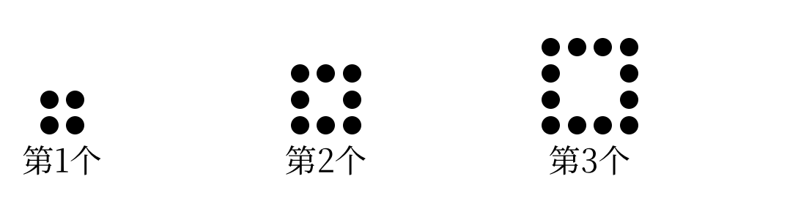
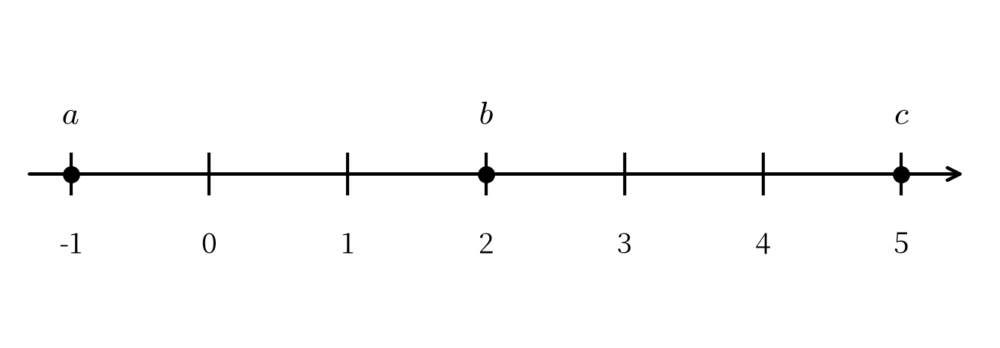
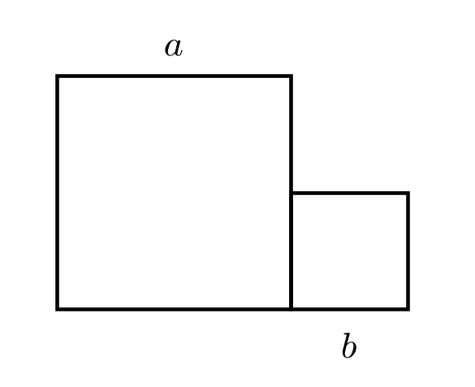
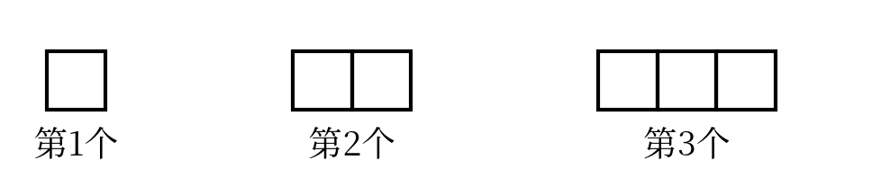

::: {custom-style="Subtitle"}
（人教版2024新教材　范围：第一章～第四章）
:::

::: {custom-style="Subtitle"}
满分120分　　考试时间120分钟
:::

::: {custom-style="Subtitle"}
班级：＿＿＿＿＿＿　　姓名：＿＿＿＿＿＿　　学号：＿＿＿＿＿＿　　得分：＿＿＿＿
:::

## 一、选择题（本大题共12个小题，每小题3分，共36分。在每小题给出的四个选项中，只有一项符合题目要求）

1．如果“减少5%”记作 $-5\%$，那么“增加8%”记作（　　）

A．$+8\%$　　　B．$-8\%$　　　C．$+3\%$　　　D．$-3\%$

2．在 $-5$，$0$，$|-3|$，$-(-2)$，$-2^{2}$，$(-2)^{3}$ 这六个数中，负数有（　　）

A．1个　　　B．2个　　　C．3个　　　D．4个

3．在数轴上，点 $A$ 表示的数是 $-1$，先将点 $A$ 向左移动3个单位长度，再向右移动5个单位长度，所得点表示的数是（　　）

A．$-9$　　　B．$1$　　　C．$3$　　　D．$9$

4．下列计算正确的是（　　）

A．$(-2)^{2}=-4$　　　B．$-(-3)^{2}=9$　　　C．$(-1)^{2026}=1$　　　D．$-2^{3}=8$

5．计算 $99\frac{8}{9}\times(-9)$ 的结果是（　　）

A．$-899$　　　B．$899$　　　C．$-900$　　　D．$-898$

6．将 $1230000000$ 用科学记数法表示为（　　）

A．$1.23\times 10^{8}$　　　B．$1.23\times 10^{9}$　　　C．$12.3\times 10^{8}$　　　D．$0.123\times 10^{10}$

7．单项式 $-\frac{2a^{2}b}{3}$ 的系数和次数分别是（　　）

A．$-\frac{2}{3}$，3　　　B．$\frac{2}{3}$，3　　　C．$-\frac{2}{3}$，2　　　D．$-\frac{2}{3}$，5

8．多项式 $3x^{2}y-2xy+5$ 的次数和常数项分别是（　　）

A．3，$5$　　　B．2，$5$　　　C．3，$-5$　　　D．2，$-5$

9．下列各组中，属于同类项的是（　　）

A．$2x^{2}y$ 与 $3yx^{2}$　　　B．$2ab$ 与 $2abc$　　　C．$3m^{2}n$ 与 $3mn^{2}$　　　D．$x^{2}$ 与 $2^{2}$

10．化简 $3(a+b)-2(a-b)$ 的结果是（　　）

A．$a+5b$　　　B．$a+b$　　　C．$a-b$　　　D．$5a+b$

11．若 $2x-y=3$，则 $4x-2y+5$ 的值是（　　）

A．$3$　　　B．$8$　　　C．$11$　　　D．$6$

12．已知 $a=-2$，$b=3$，则 $|a+b|-|a-b|$ 的化简结果是（　　）

A．$2a$　　　B．$-2a$　　　C．$2b$　　　D．$-2b$

## 二、填空题（本大题共6个小题，每小题4分，共24分）

13．单项式 $\frac{3xy^{2}}{5}$ 的系数是　　　　，次数是　　　　．

14．多项式 $-2x^{2}y+3xy-1$ 的次数是　　　　，常数项是　　　　．

15．若 $2x^{m}y$ 与 $-3x^{2}y^{n}$ 是同类项，则 $m+n$=　　　　．

16．已知 $A=2x^{2}-3x+1$，$B=2x^{2}-4x+8$，则 $A-B$=　　　　．

17．已知 $a^{2}+a=1$，则 $3a^{2}+3a-5$=　　　　．

18．如图，用同样大小的小圆点按下列方式摆放：

{width=9cm}

（1）第10个图形有　　　　个小圆点；

（2）第 $n$ 个图形有　　　　个小圆点（用含 $n$ 的代数式表示）．

## 三、解答题（本大题共8个小题，共60分。解答应写出必要的文字说明、演算步骤或推理过程）

19．（6分）计算：

（1）$(-18)\div(-3)\times\left(-\frac{1}{2}\right)$；

（2）$-1^{2026}+(-2)^{3}\div 4-(-5)$．

```{=openxml}
<w:p/><w:p/><w:p/><w:p/><w:p/>
```

20．（6分）化简：

（1）$5x^{2}-3x-2x^{2}+4x-1$；

（2）$3(x^{2}-2x+1)-(3x^{2}-4x)$．

```{=openxml}
<w:p/><w:p/><w:p/><w:p/><w:p/>
```

21．（8分）已知 $A=2x^{2}+3xy-1$，$B=x^{2}-xy+2$。

（1）求 $A-2B$；（4分）

（2）当 $x=-1$，$y=2$ 时，求 $A-2B$ 的值。（4分）

```{=openxml}
<w:p/><w:p/><w:p/><w:p/><w:p/><w:p/>
```

22．（8分）如图，数轴上点 $A$，$B$，$C$ 表示的数分别为 $a$，$b$，$c$。

{width=10cm}

（1）比较 $a$，$b$，$c$ 的大小，并用“＜”连接；（2分）

（2）化简 $|a+b|+|c-b|-|a|$；（4分）

（3）求（2）中所化简式子的值。（2分）

```{=openxml}
<w:p/><w:p/><w:p/><w:p/><w:p/><w:p/>
```

23．（8分）学校购进甲、乙两种图书，甲种图书每本 $a$ 元，乙种图书每本 $b$ 元，且甲种图书每本比乙种图书多25元。

（1）购买甲种图书10本、乙种图书15本，共需多少元？（用含 $a$，$b$ 的代数式表示）（3分）

（2）用含 $a$ 的代数式表示（1）中的总费用；（3分）

（3）若 $a=43$，求（1）中的总费用。（2分）

```{=openxml}
<w:p/><w:p/><w:p/><w:p/><w:p/><w:p/>
```

```{=openxml}
<w:p><w:r><w:br w:type="page"/></w:r></w:p>
```

24．（8分）如图，两个正方形的边长分别为 $a$，$b$（$a>b$），它们的一条边重合。

{width=6cm}

（1）用含 $a$，$b$ 的代数式表示组合图形的周长；（3分）

（2）当 $a=5$，$b=3$ 时，求组合图形的周长；（2分）

（3）当 $a=5$，$b=3$ 时，求组合图形的面积。（3分）

```{=openxml}
<w:p/><w:p/><w:p/><w:p/><w:p/><w:p/>
```

25．（8分）如图，用边长为1的小正方形按下列方式拼成一排长方形。

{width=8cm}

（1）第4个图形的周长是多少？（2分）

（2）用含 $n$ 的代数式表示第 $n$ 个图形的周长；（4分）

（3）第 $n$ 个图形的周长能否等于2027？请说明理由。（2分）

```{=openxml}
<w:p/><w:p/><w:p/><w:p/><w:p/><w:p/>
```

26．（8分）已知 $|a+1|+(b-2)^{2}=0$。

（1）求 $a$，$b$ 的值；（3分）

（2）化简 $3(2a^{2}-ab)-2(3a^{2}-2ab)$；（3分）

（3）利用（1）（2）的结果，求 $3(2a^{2}-ab)-2(3a^{2}-2ab)$ 的值。（2分）

```{=openxml}
<w:p><w:r><w:br w:type="page"/></w:r></w:p>
```

## 参考答案与解析（第四套）

### 一、选择题（每小题3分，共36分）

| 题号 | 1 | 2 | 3 | 4 | 5 | 6 | 7 | 8 | 9 | 10 | 11 | 12 |
|:---:|:---:|:---:|:---:|:---:|:---:|:---:|:---:|:---:|:---:|:---:|:---:|:---:|
| 答案 | A | C | B | C | A | B | A | A | A | A | C | A |

### 二、填空题（每小题4分，共24分）

| 题号 | 13 | 14 | 15 |
|:---:|:---:|:---:|:---:|
| 答案 | $\frac{3}{5}$；3 | 3；$-1$ | $3$ |
| 题号 | 16 | 17 | 18 |
| 答案 | $x-7$ | $-2$ | $4n$；40 |

### 三、解答题

19．（6分）

（1）原式：$6\times\left(-\frac{1}{2}\right)=-3$．（3分）

（2）原式：$-1+(-8)\div 4+5=-1-2+5=2$．（3分）

20．（6分）

（1）原式：$(5x^{2}-2x^{2})+(-3x+4x)-1=3x^{2}+x-1$．（3分）

（2）原式：$3x^{2}-6x+3-3x^{2}+4x=-2x+3$．（3分）

21．（8分）

（1）$A-2B=(2x^{2}+3xy-1)-2(x^{2}-xy+2)=2x^{2}+3xy-1-2x^{2}+2xy-4=5xy-5$．（4分）

（2）当 $x=-1$，$y=2$ 时，$5xy-5=5\times(-1)\times 2-5=-10-5=-15$．（4分）

22．（8分）

（1）由数轴可知 $a<b<c$，即 $-1<2<5$．（2分）

（2）因为 $a+b>0$，$c-b>0$，$a<0$，所以 $|a+b|=a+b$，$|c-b|=c-b$，$|a|=-a$．所以原式：$(a+b)+(c-b)+a=2a+c$．（4分）

（3）当 $a=-1$，$c=5$ 时，$2a+c=2\times(-1)+5=3$．（2分）

23．（8分）

（1）共需 $(10a+15b)$ 元．（3分）

（2）因为 $a=b+25$，所以 $b=a-25$，总费用为 $10a+15(a-25)=10a+15a-375=25a-375$（元）．（3分）

（3）当 $a=43$ 时，$25a-375=25\times 43-375=1075-375=700$（元）．答：总费用是700元．（2分）

24．（8分）

（1）组合图形的周长为 $4a+4b-2b=4a+2b$．（3分）

（2）当 $a=5$，$b=3$ 时，$4a+2b=4\times 5+2\times 3=26$．答：周长是26．（2分）

（3）组合图形的面积为 $a^{2}+b^{2}$，当 $a=5$，$b=3$ 时，$a^{2}+b^{2}=25+9=34$．答：面积是34．（3分）

25．（8分）

（1）第1个图形的周长是4，以后每增加1个小正方形，周长增加2，所以第4个图形的周长为 $4+2\times 3=10$．（2分）

（2）第 $n$ 个图形的周长为 $4+2(n-1)=2n+2$．（4分）

（3）不能．理由：由 $2n+2=2027$ 得 $2n=2025$，$n=1012.5$，而 $n$ 必须是正整数，所以周长不能等于2027．（2分）

26．（8分）

（1）因为 $|a+1|\geq 0$，$(b-2)^{2}\geq 0$，且它们的和为0，所以 $a+1=0$，$b-2=0$，得 $a=-1$，$b=2$．（3分）

（2）$3(2a^{2}-ab)-2(3a^{2}-2ab)=6a^{2}-3ab-6a^{2}+4ab=ab$．（3分）

（3）当 $a=-1$，$b=2$ 时，$ab=(-1)\times 2=-2$．（2分）

> 易错点：第22（2）问先去绝对值时必须先判断绝对值内式子的符号，再按“正数不变、负数变相反数”去掉绝对值符号；第23（2）问应先由“甲比乙多25元”得出 $b=a-25$，再整体代入。
