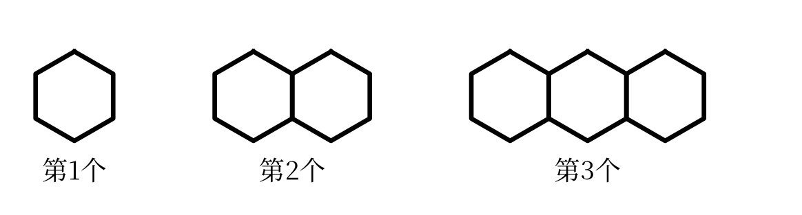
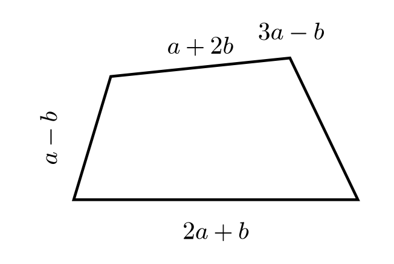

::: {custom-style="Subtitle"}
（人教版2024新教材　范围：第一章～第四章）
:::

::: {custom-style="Subtitle"}
满分120分　　考试时间120分钟
:::

::: {custom-style="Subtitle"}
班级：＿＿＿＿＿＿　　姓名：＿＿＿＿＿＿　　学号：＿＿＿＿＿＿　　得分：＿＿＿＿
:::

## 一、选择题（本大题共12个小题，每小题3分，共36分。在每小题给出的四个选项中，只有一项符合题目要求）

1．规定零件的标准尺寸为基准，超过标准尺寸的部分记为正，不足的记为负。四个零件的尺寸偏差分别为 $+0.02$ mm，$-0.03$ mm，$+0.01$ mm，$-0.02$ mm，其中误差最大的是（　　）

A．$+0.02$ mm　　　B．$-0.03$ mm　　　C．$+0.01$ mm　　　D．$-0.02$ mm

2．计算 $-2^{2}+(-1)^{3}$ 的结果是（　　）

A．$-5$　　　B．$5$　　　C．$-3$　　　D．$3$

3．若 $a=-3$，$b=-\frac{1}{2}$，则 $a\div b$ 的值是（　　）

A．$6$　　　B．$-6$　　　C．$\frac{1}{6}$　　　D．$-\frac{1}{6}$

4．某市常住人口约为 $1.2\times 10^{6}$ 人，则这个人口数用普通形式表示为（　　）

A．$120000$ 人　　　B．$1200000$ 人　　　C．$12000000$ 人　　　D．$120000000$ 人

5．下列各式中，属于多项式的是（　　）

A．$\frac{2}{x}$　　　B．$x^{2}-3x+1$　　　C．$0$　　　D．$-5x$

6．化简 $-(x^{3}-2x^{2}+5)$ 的结果是（　　）

A．$-x^{3}+2x^{2}-5$　　　B．$-x^{3}-2x^{2}+5$　　　C．$-x^{3}+2x^{2}+5$　　　D．$x^{3}-2x^{2}+5$

7．合并同类项 $2x^{2}y-3x^{2}y$ 的结果是（　　）

A．$-x^{2}y$　　　B．$-x^{2}$　　　C．$x^{2}y$　　　D．$-5x^{2}y$

8．一个长方形的长为 $(2a+b)$，宽为 $(a-b)$，则它的周长是（　　）

A．$6a$　　　B．$3a$　　　C．$6a+4b$　　　D．$6a-4b$

9．已知 $a^{2}+2a=5$，则 $3a^{2}+6a-7$ 的值是（　　）

A．$8$　　　B．$15$　　　C．$22$　　　D．$-7$

10．已知 $a=-4$，$b=1$，则下列各式正确的是（　　）

A．$a+b>0$　　　B．$ab>0$　　　C．$|a|<|b|$　　　D．$b-a>0$

11．若 $a$ 是最小的正整数，$b$ 是最大的负整数，则 $a-b$ 的值是（　　）

A．$2$　　　B．$0$　　　C．$-2$　　　D．$1$

12．若 $|x-1|=2$，则 $x$ 的值是（　　）

A．$3$　　　B．$-1$　　　C．$3$ 或 $-1$　　　D．$-3$ 或 $1$

## 二、填空题（本大题共6个小题，每小题4分，共24分）

13．某国一年的国内生产总值约为126万亿元，126万亿用科学记数法表示为　　　　元．

14．若 $a^{2}=16$，则 $a$=　　　　．

15．计算：$-2^{2}+|-6|\div(-3)$=　　　　．

16．化简：$(3a^{2}+4a-1)-(2a^{2}-3a+1)$=　　　　．

17．某商品原价 $a$ 元，打八折后的售价为　　　　元；若 $a=250$，则售价为　　　　元．

18．如图，用火柴棒按下列方式搭正六边形：

{width=9cm}

（1）第4个图形用　　　　根火柴棒；

（2）第 $n$ 个图形用　　　　根火柴棒（用含 $n$ 的代数式表示）．

## 三、解答题（本大题共8个小题，共60分。解答应写出必要的文字说明、演算步骤或推理过程）

19．（6分）计算：

（1）$(-19)-(-11)+(-8)$；

（2）$-3^{2}\times\left(-\frac{1}{3}\right)-(-2)^{3}\div 4$．

```{=openxml}
<w:p/><w:p/><w:p/><w:p/><w:p/>
```

20．（6分）化简：

（1）$4x^{2}-3x-2x^{2}+3x-2$；

（2）$3a^{2}b+4a^{2}b-5ab^{2}+3ab^{2}$．

```{=openxml}
<w:p/><w:p/><w:p/><w:p/><w:p/>
```

21．（8分）先化简，再求值：

$(5a^{2}+ab)-(a^{2}-2ab)$，其中 $a=-1$，$b=2$。

```{=openxml}
<w:p/><w:p/><w:p/><w:p/><w:p/><w:p/>
```

22．（8分）小明化简 $2x^{2}-(x^{2}+4x-5)$ 时，是这样做的：

原式：$2x^{2}-x^{2}+4x-5=x^{2}+4x-5$。

（1）请指出小明的错误原因；（3分）

（2）写出正确的化简过程与结果；（3分）

（3）当 $x=1$ 时，求这个代数式的值。（2分）

```{=openxml}
<w:p/><w:p/><w:p/><w:p/><w:p/><w:p/>
```

23．（8分）某服装店以每件 $a$ 元购进一批T恤，以每件 $b$ 元售出，且 $b=a+40$。

（1）售出30件，用含 $a$ 的代数式表示销售额；（3分）

（2）这30件T恤全部售出后，共盈利多少元？（3分）

（3）若 $a=160$，求这30件T恤的销售额。（2分）

```{=openxml}
<w:p/><w:p/><w:p/><w:p/><w:p/><w:p/>
```

24．（8分）如图，一个四边形的四条边长分别为 $2a+b$，$3a-b$，$a+2b$，$a-b$。

{width=6cm}

（1）用含 $a$，$b$ 的代数式表示这个四边形的周长；（3分）

（2）当 $a=5$，$b=2$ 时，求这个四边形的周长；（2分）

（3）当 $a=5$，$b=2$ 时，求这个四边形最长边与最短边的差。（3分）

```{=openxml}
<w:p/><w:p/><w:p/><w:p/><w:p/><w:p/>
```

25．（8分）观察下列各数：

$2^{1}=2$，$2^{2}=4$，$2^{3}=8$，$2^{4}=16$，$2^{5}=32$，$2^{6}=64$，…

可以发现，$2^{n}$ 的个位数字按2，4，8，6的顺序循环出现。

（1）求 $2^{2026}$ 的个位数字；（3分）

（2）求 $2^{1}+2^{2}+2^{3}+\cdots+2^{2026}$ 的个位数字；（3分）

（3）求 $2^{2026}-1$ 的个位数字。（2分）

```{=openxml}
<w:p/><w:p/><w:p/><w:p/><w:p/><w:p/>
```

26．（8分）已知 $A=2xy-3$，$B=-x$。

（1）求 $3A+6B$；（3分）

（2）若 $3A+6B$ 的值与 $x$ 的取值无关，求 $y$ 的值；（3分）

（3）当 $x=2$，$y=1$ 时，求 $3A+6B$ 的值。（2分）

```{=openxml}
<w:p><w:r><w:br w:type="page"/></w:r></w:p>
```

## 参考答案与解析（第五套）

### 一、选择题（每小题3分，共36分）

| 题号 | 1 | 2 | 3 | 4 | 5 | 6 | 7 | 8 | 9 | 10 | 11 | 12 |
|:---:|:---:|:---:|:---:|:---:|:---:|:---:|:---:|:---:|:---:|:---:|:---:|:---:|
| 答案 | B | A | A | B | B | A | A | A | A | D | A | C |

### 二、填空题（每小题4分，共24分）

| 题号 | 13 | 14 | 15 |
|:---:|:---:|:---:|:---:|
| 答案 | $1.26\times 10^{14}$ | $\pm 4$ | $-6$ |
| 题号 | 16 | 17 | 18 |
| 答案 | $a^{2}+7a-2$ | $0.8a$；200 | 21；$5n+1$ |

### 三、解答题

19．（6分）

（1）原式：$-19+11-8=-16$．（3分）

（2）原式：$3-(-2)=3+2=5$．（3分）

20．（6分）

（1）原式：$(4x^{2}-2x^{2})+(-3x+3x)-2=2x^{2}-2$．（3分）

（2）原式：$(3a^{2}b+4a^{2}b)+(-5ab^{2}+3ab^{2})=7a^{2}b-2ab^{2}$．（3分）

21．（8分）

原式：$5a^{2}+ab-a^{2}+2ab=4a^{2}+3ab$．（5分）

当 $a=-1$，$b=2$ 时，$4a^{2}+3ab=4\times 1+3\times(-1)\times 2=4-6=-2$．（3分）

22．（8分）

（1）小明的错误在于去括号时没有把括号内各项都变号。括号前是“$-$”号，去掉括号后，括号里的 $4x$ 应变为 $-4x$，$-5$ 应变为 $+5$，而小明只改变了第一项的符号。（3分）

（2）正确过程：$2x^{2}-(x^{2}+4x-5)=2x^{2}-x^{2}-4x+5=x^{2}-4x+5$．（3分）

（3）当 $x=1$ 时，$x^{2}-4x+5=1-4+5=2$．（2分）

23．（8分）

（1）销售额为 $30b=30(a+40)=30a+1200$（元）．答：销售额为 $(30a+1200)$ 元．（3分）

（2）每件盈利 $b-a=40$（元），30件共盈利 $40\times 30=1200$（元）．答：共盈利1200元．（3分）

（3）当 $a=160$ 时，$30a+1200=30\times 160+1200=4800+1200=6000$（元）．答：销售额为6000元．（2分）

24．（8分）

（1）周长为 $(2a+b)+(3a-b)+(a+2b)+(a-b)=7a+b$．（3分）

（2）当 $a=5$，$b=2$ 时，$7a+b=7\times 5+2=37$．答：周长是37．（2分）

（3）四条边长分别为 $2a+b=12$，$3a-b=13$，$a+2b=9$，$a-b=3$，最长边为13，最短边为3，$13-3=10$．答：最长边与最短边的差是10．（3分）

25．（8分）

（1）因为 $2026\div 4=506\cdots\cdots 2$，所以 $2^{2026}$ 的个位数字与 $2^{2}$ 的个位数字相同，为4．（3分）

（2）每4个数的个位数字之和为 $2+4+8+6=20$，个位数字是0。因为 $2026=4\times 506+2$，所以前2024个数的个位数字之和的个位是0，再加上 $2^{2025}$ 与 $2^{2026}$ 的个位数字2和4，得 $2+4=6$，所以所求个位数字是6．（3分）

（3）$2^{2026}$ 的个位数字是4，$4-1=3$，所以 $2^{2026}-1$ 的个位数字是3．（2分）

26．（8分）

（1）$3A+6B=3(2xy-3)+6(-x)=6xy-9-6x=6xy-6x-9$．（3分）

（2）$6xy-6x-9=(6y-6)x-9$．因为它的值与 $x$ 的取值无关，所以 $6y-6=0$，解得 $y=1$．（3分）

（3）当 $x=2$，$y=1$ 时，$6xy-6x-9=6\times 2\times 1-6\times 2-9=12-12-9=-9$．（2分）

> 易错点：第22（1）问“去括号”时括号前是负号，括号内每一项都要变号，不能只改变第一项；第25问要抓住“每4个一循环”的周期规律，用余数确定位置。
